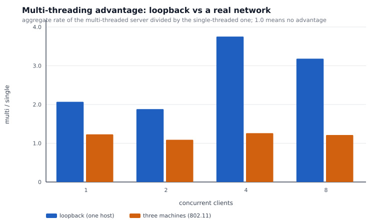
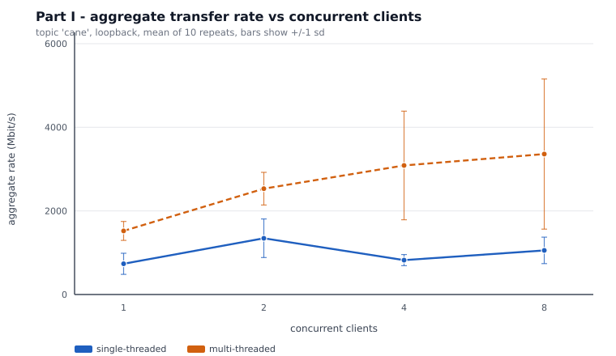
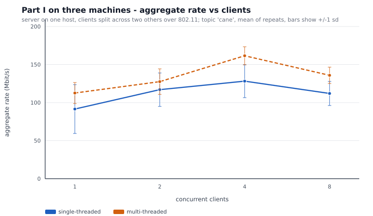
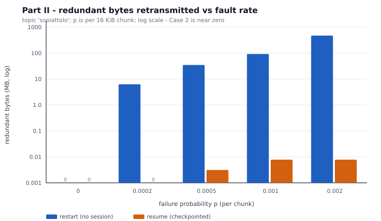
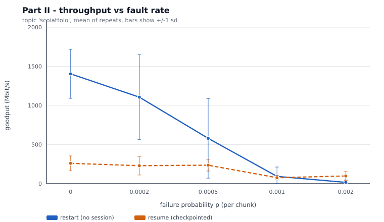
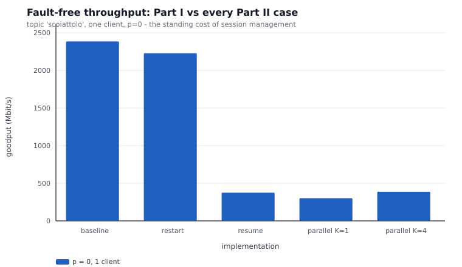
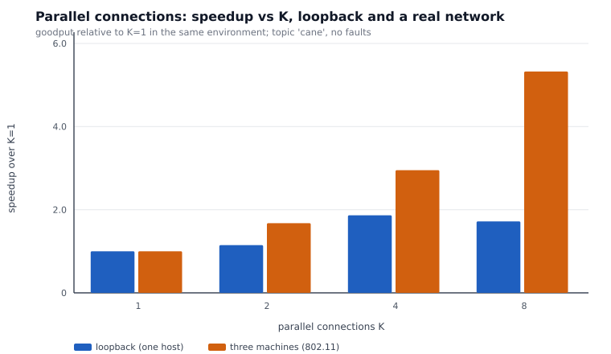

# Benchmarks

Every figure here comes from `docs/results/`. Each cell is a mean over repeats;
`±` is the standard deviation across those repeats. Raw per-run rows are in
`bench_runs.csv` (340 rows) and `distributed/bench_runs_dist.csv` (52 rows), so
anything below can be recomputed rather than taken on trust.

---

## Method

| | |
|---|---|
| Runs recorded | **392** — 340 on loopback, 52 across three machines |
| Repeats | 10 per configuration on loopback, 5 (threading) and 3 (parallel) on hardware |
| Files received and CRC-verified | **2,935,076** |
| CRC mismatches | **0** |
| Reported | mean ± standard deviation, never a single sample |

**Controls.** The page cache is warmed before any timed run. Threading modes
are interleaved *within* each repeat rather than run in blocks, so drift
affects both equally. Clients are dealt alternately to the two client machines.
Timing uses a monotonic clock, with the wall-clock span recorded alongside it.

[FINDINGS.md](FINDINGS.md) explains why each of those controls exists — each
one was added after it had already corrupted a result.

### Environments

| | Loopback | Three machines |
|---|---|---|
| Server | WSL2, Core Ultra 5 125H, 18 logical cores | same host |
| Clients | same host | 2 × MacBook (macOS) |
| Link | loopback | 802.11, single subnet |
| Peak observed | ~2400 Mbit/s | 178 Mbit/s |

---

## 1. Threading — the headline comparison

Topic `cane`: 4,863 files, 57.9 MB, no faults.

### Loopback

| clients | single, makespan | multi, makespan | single Mbit/s | multi Mbit/s |
|---:|---:|---:|---:|---:|
| 1 | 0.73 ±0.22 | 0.33 ±0.05 | 735 ±253 | 1521 ±226 |
| 2 | 0.81 ±0.26 | 0.40 ±0.08 | 1346 ±462 | 2532 ±391 |
| 4 | 2.43 ±0.44 | 1.04 ±1.18 | 823 ±133 | 3087 ±1298 |
| 8 | 4.01 ±1.12 | 1.45 ±0.59 | 1056 ±317 | **3361 ±1796** |

Speedup at 8 clients: **3.18×**

### Three machines

| clients | single, makespan | multi, makespan | single Mbit/s | multi Mbit/s | speedup |
|---:|---:|---:|---:|---:|---:|
| 1 | 6.62 | 4.38 | 92 | 113 | 1.23× |
| 2 | 8.61 | 7.76 | 117 | 128 | 1.09× |
| 4 | 15.58 | 12.09 | 128 | 162 | 1.27× |
| 8 | 35.34 | 28.77 | 112 | 136 | **1.21×** |

**3.18× → 1.21×.** On loopback the bottleneck is CPU and extra threads convert
it directly into throughput. On a real link one thread already saturates the
medium, so the remaining headroom is small. The benefit was overstated **2.6×**.







---

## 2. Restart vs resume across the fault rate

Topic `scoiattolo`: 1,862 files, 24.2 MB, **C = 1551 chunks**. `p` applies per
16 KiB chunk, so expected faults per pass is `C·p`.

### restart

| p | expected faults/pass | makespan | Mbit/s | redundant MB | × topic | reconnects |
|---:|---:|---:|---:|---:|---:|---:|
| 0 | 0.00 | 0.15 ±0.04 | 1404 | 0.0 | 0.00 | 0.0 |
| 0.0002 | 0.31 | 0.28 ±0.23 | 1106 | 6.3 ±10.6 | 0.26 | 0.6 |
| 0.0005 | 0.78 | 1.50 ±1.81 | 579 | 34.8 ±38.0 | 1.44 | 3.1 |
| 0.001 | 1.55 | 6.73 ±5.26 | 93 | 92.1 ±59.8 | 3.80 | 12.9 |
| 0.002 | 3.10 | **52.01 ±43.92** | 16 | **471.8 ±363.3** | **19.47** | 96.0 |

### resume

| p | expected faults/pass | makespan | Mbit/s | redundant MB | reconnects |
|---:|---:|---:|---:|---:|---:|
| 0 | 0.00 | 0.86 ±0.22 | 260 | **0.0** | 0.0 |
| 0.0002 | 0.31 | 1.21 ±0.69 | 230 | **0.0** | 0.5 |
| 0.0005 | 0.78 | 1.05 ±0.66 | 236 | **0.0** | 1.7 |
| 0.001 | 1.55 | 3.03 ±1.04 | 76 | **0.0** | 5.4 |
| 0.002 | 3.10 | **3.33 ±3.10** | 98 | **0.0** | 8.0 |

Two things to read off this:

**Zero redundant bytes, everywhere.** Not "small" — zero, across 50 runs with
up to 96 reconnects. A resume implementation that re-sends is wasteful and one
that skips is corrupting; both failure modes are pinned to zero at once.

**Restart is superlinear.** From p = 0.001 to p = 0.002 the fault rate doubles
and the time goes up **7.7×** (6.73 → 52.01 s). And the deviation at p = 0.002
is 84% of the mean: restart is not merely slow, it is unpredictable, because
completion depends on the worst luck in the whole run rather than the average.





---

## 3. The crossover, derived and then measured

Resume is not free. On an identical workload with **no faults**:

| implementation | makespan | Mbit/s | vs baseline | overhead % |
|---|---:|---:|---:|---:|
| baseline (multi-threaded) | 0.09 ±0.01 | **2384 ±350** | 1.00× | 0.458 |
| restart | 0.10 ±0.03 | 2228 ±521 | 0.93× | 0.458 |
| **resume** | 0.56 ±0.08 | **375 ±57** | **0.16×** | 0.619 |
| parallel, K=1 | 0.69 ±0.10 | 301 ±39 | 0.13× | 0.962 |
| parallel, K=4 | 0.53 ±0.04 | 387 ±31 | 0.16× | 0.962 |

*(This experiment exists so the comparison is like-for-like: the other tables
each use whichever topic suits what they measure, so their p = 0 rows sit on
different workloads and cannot be divided by one another.)*



Resume costs **6.4×** in clean throughput — per-chunk acknowledgements cost a
round trip, checkpoints cost fsync'd disk writes.

So the two designs do not differ by a constant factor. Restart's expected cost
multiplier is `(1-p)^(-C) ≈ e^(C·p)`, which is **exponential in transfer
length**, while resume's cost is linear in the number of faults. A constant
factor always loses to an exponential eventually; the only question is where.

```
resume wins when   e^(C·p) > 6.4
                     C·p   > ln(6.4) ≈ 1.85
                       p   > 1.85 / 1551 ≈ 0.0012
```

Measured:

| p | restart | resume | winner |
|---:|---:|---:|---|
| 0.001 | 93 Mbit/s | 76 Mbit/s | **restart** |
| 0.002 | 16 Mbit/s | 98 Mbit/s | **resume** |

**The flip happens between 0.001 and 0.002. The derivation predicted 0.0012.**
The prediction and the measurement were produced independently — the threshold
comes from two separately measured quantities (the 6.4× clean-case penalty and
the chunk count), not fitted to the curve.

### Large files

Topic `gatto`, 144 MB, where single files are big. At p = 0.0001 — a fault rate
**twenty times lower**:

| | makespan | Mbit/s | redundant MB |
|---|---:|---:|---:|
| restart | 1.00 ±0.80 | 2208 | **156.0 ±156.2** |
| resume | 1.18 ±0.93 | 1287 | **0.0** |

Restart re-sent 156 MB — **more than the entire topic** — on roughly one
expected fault. Large files are where restart hurts most, because a fault late
in a big file discards the most work.

---

## 4. Parallel connections

### Loopback, fault-free

| K | makespan | Mbit/s | speedup |
|---:|---:|---:|---:|
| 1 | 3.65 ±2.25 | 196 | 1.00× |
| 2 | 2.63 ±1.10 | 225 | 1.15× |
| 4 | 1.39 ±0.34 | 366 | **1.87×** |
| 8 | 1.68 ±1.01 | 337 | 1.72× |

**K=8 is worse than K=4.** With no latency to hide, additional connections
contend for the same CPU and pay coordination overhead for nothing.

### Three machines, fault-free

| K | makespan | Mbit/s | speedup |
|---:|---:|---:|---:|
| 1 | 54.88 | 9 | 1.00× |
| 2 | 32.82 | 15 | 1.67× |
| 4 | 18.87 | 26 | 2.91× |
| 8 | 10.29 | 47 | **5.33×** |

**1.72× → 5.33×, and still climbing at K=8.** A single TCP stream leaves the
link idle while it waits for acknowledgements; K streams fill those gaps. The
ceiling was never found, so this is a trend, not a maximum.



### Under faults

| K | makespan | Mbit/s | speedup | reconnects |
|---:|---:|---:|---:|---:|
| 1 | 3.26 ±0.98 | 161 | 1.00× | 5.7 |
| 4 | 1.49 ±0.20 | 331 | **2.06×** | 5.7 |

Same number of faults, **2.06× faster**, because a broken connection costs one
byte range while the other three keep working.

---

## 5. Runs behind each figure

| Figure | Runs |
|---|---:|
| Any single cell in the tables above | 10 (loopback), 3–5 (hardware) |
| 3.18× threading speedup | 20 |
| 1.21× threading speedup on hardware | 10 |
| restart vs resume at p = 0.002 | 20 |
| 6.4× clean-case cost of resume | 20 |
| 5.33× at K=8 on hardware | 6 |
| 0 CRC failures | **all 392 runs** |

---

## Reproducing

```bash
make bench                 # full sweep, writes to docs/results/
python3 bench/summarize.py # regenerate the summary tables
python3 bench/plot_results.py
```

The three-machine runs need three hosts; `bench/run_dist.sh` drives them over
SSH. `docker compose up` approximates the shape on one machine, but containers
on a bridge network share a kernel, so those numbers sit closer to loopback
than to a real link — which is the entire point of the comparison above.

## A note on the first distributed pass

`docs/results/distributed_pass1/` holds 40 runs that are **biased**: all
single-threaded runs executed before all multi-threaded ones, with a cold page
cache at the start. It is kept, labelled, with its own README. The corrected
run is `docs/results/distributed/`. Deleting the flawed pass would hide a real
result about method, and the difference between the two is itself evidence that
the control matters.
